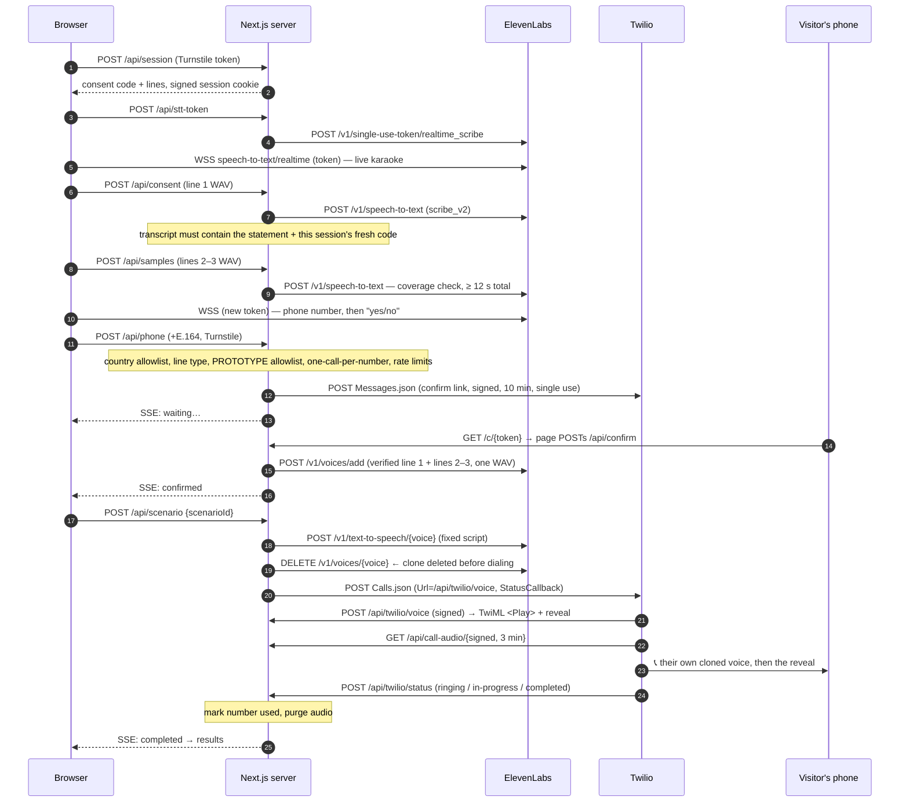

# Deepfake call demo · Noon by Aikido

A visitor **speaks, never types**:
1. They read three short lines aloud, including a random spoken consent code.
2. They say their phone number and confirm it from an SMS link.
3. They pick a scenario.
4. Their phone rings: an AI clone of **their own voice** plays a short social-engineering script, then a neutral voice reveals the trick.

The demo can only clone the person in front of the mic, and it can only call that person's own verified number.

```
npm install
cp .env.example .env.local          # set MOCK_PROVIDERS=true to click through without keys
npm run dev                         # http://localhost:3000
npm test                            # unit tests (matching, consent gate, phone rules, tokens, WAV)
```

---

## 1. Architecture

### File structure

```
app/
  page.tsx                      → <DemoApp/> (single-page, voice-driven flow)
  c/[token]/                    SMS confirm page (confirms via POST from the browser, not on GET)
  api/
    session/                    POST start (Turnstile + rate limit) · GET snapshot
    session/events/             SSE: pushes session snapshot on every change
    stt-token/                  single-use ElevenLabs realtime token for the browser
    consent/                    line-1 WAV → server STT must contain this session's code
    samples/                    lines 2–3 WAV → server STT sanity check, kept in memory
    phone/ · phone/resend/      validate number (allowlists, line type) → send SMS link
    confirm/                    consume single-use signed link → start cloning
    scenario/                   scenario ID only → TTS → delete clone → dial
    call/retry/                 one retry if the first call wasn't answered
    finish/                     results reached → wipe clone + audio now
    twilio/voice/               TwiML (signature-checked): <Play> clone audio, then reveal
    twilio/status/              call status callback (signature-checked)
    call-audio/[token]/         short-lived signed MP3 URL that Twilio <Play> fetches
    lead/                       work email for the team simulation CTA
components/
  DemoApp.tsx                   step machine, SSE, transitions, error recovery
  screens/                      Landing · Training · Phone · SmsWait · Scenario · Calling · Results · Problem
  Karaoke.tsx                   word-by-word highlighting
  ui.tsx                        VoiceOrb (canvas level meter), buttons, hints
  useVoice.ts                   mic + realtime STT lifecycle hook
lib/
  text.ts                       isomorphic: normalisation, number words, fuzzy line matching, yes/no, phone
  scenarios.ts · lines.ts       public scenario metadata, read-aloud lines
  wav.ts                        16-bit mono WAV encode / strict decode
  client/                       mic.ts (AudioWorklet capture), stt.ts (Scribe WebSocket), api.ts, turnstile.ts
  server/                       config, store (in-memory TTL), pipeline (the whole flow), elevenlabs, twilio,
                                phone (libphonenumber max), scripts (fixed TTS text), crypto, ratelimit, log
public/worklets/capture.js      AudioWorklet: batches mic frames to the main thread
tests/                          node:test via tsx
```

### Realtime STT approach

* The **browser** asks our server for a **single-use token**. The server calls `POST /v1/single-use-token/realtime_scribe`, so the API key never leaves the server. Each token is valid for 15 minutes and works once.
* The browser opens a WebSocket **directly to ElevenLabs** at `wss://api.elevenlabs.io/v1/speech-to-text/realtime` with these parameters:
  * `model_id=scribe_v2_realtime`
  * `audio_format=pcm_16000`
  * `commit_strategy=vad`
  * `vad_silence_threshold_secs=0.8`
  * `language_code=en`
* An **AudioWorklet** captures the mic at its native rate and feeds two consumers:
  * a box-filter downsample to **16 kHz Int16**, sent as ~100 ms `input_audio_chunk` messages (base64, `sample_rate: 16000`), within the recommended 0.1–1 s chunk size;
  * a **full-rate Int16 recording** that is sliced per line for cloning. The audio comes only from this live capture; there is no upload control anywhere.
* `partial_transcript` and `committed_transcript` messages feed a `Transcript` buffer. Each screen or line calls `reset()`, so it only sees new speech.
* **Karaoke matching** (`lib/text.ts → matchLine`) works like this:
  * Normalise case and punctuation, and turn spoken numbers into digits ("forty-seven" → `47`).
  * Align greedily in order with a small look-ahead.
  * Use Levenshtein tolerance of about 34% per word, and accept partial words at the end of a partial transcript.
  * Everything before the last matched word is painted, so one missed word never blocks the highlight.
  * Auto-advance happens at **≥ 80 %** of words matched, once the last word is heard or after a short silence. Line 1 waits longer, because the code comes last.
* **The live transcript is UI only.** The anti-abuse decision is made server-side on the actual audio (see below).

### Sequence of API calls



## 2. Safeguards

| Requirement | Implementation |
|---|---|
| Live recording only | Audio comes from the AudioWorklet capture. There is no file input. The server only accepts the exact WAV format our recorder produces (16-bit mono, 16–48 kHz). |
| Random spoken consent code verified server-side | Each session gets a fresh word plus a 2-digit number (21–99, never a multiple of 10). The server runs **batch STT on the uploaded line-1 audio**. It requires ≥ 60 % of the consent statement, the code word (fuzzy), and the exact number within 3 words after it. Only that verified audio is stored, and it is **always concatenated into the clone input**, so a clone can't exist without the code in its own training audio. Max 5 attempts. |
| Lines 2–3 are really read | Server STT coverage ≥ 50 % of the expected text, and ≥ 12 s of audio in total. |
| Call only a number confirmed via SMS link | HMAC-signed link with `{session, nonce}`. It expires in 10 min, and the nonce is consumed and rotated on resend. Confirmation happens via POST from the page's JS, so link-preview bots can't consume it. |
| One call per number | Keyed hash (HMAC) of the E.164 number, stored once a call is answered. Checked before SMS and again before dialing. One retry is allowed only if unanswered. |
| Fixed scripts only | The client sends a `ScenarioId`. Script text lives in `lib/server/scripts.ts` (`server-only`). No request text ever reaches TTS. |
| Delete clone + audio | The **clone is deleted right after TTS, before dialing**. Raw recordings are wiped right after cloning. Call audio is wiped when the call ends, and also when the results screen loads. A sweep every 20 s destroys any clone or audio **10 minutes after session start**, whatever happened. |
| Rate limits | Per IP: sessions 5/min and 20/h, SMS 5/h, plus per-route limits. Per number: SMS 3/h. Per session: 3 sends per number and 4 SMS in total. Resend cooldown 30 s. |
| Invisible captcha | Cloudflare Turnstile (`appearance: interaction-only`) on session start and on phone submit. It is required in production. |
| Country allowlist, no premium-rate | `libphonenumber-js/max` `getType()` blocks premium-rate, shared-cost, toll-free, VoIP, UAN, pager, voicemail and personal numbers. Only mobile (or fixed-line-or-mobile) numbers are accepted. `ALLOWED_COUNTRY_CODES` takes ISO regions and/or calling codes. |
| PROTOTYPE MODE (default ON) | Only `ALLOWED_NUMBERS` can be texted **or** called. This is checked at SMS time and re-checked right before dialing. |
| Never log audio, transcripts or full numbers | A structured logger redacts sensitive keys, and numbers are only logged masked (`+32 •••••••56`). Provider error messages are scrubbed of digit runs. Nothing is written to disk. |
| Webhook integrity | `twilio.validateRequest` on both Twilio webhooks, against `APP_BASE_URL` + path + query, so ngrok host rewriting doesn't break it. Session, status, TwiML and audio URLs each carry their own purpose-bound HMAC token. |

## 3. Setup

### Prerequisites
* Node 20+ (tested on Node 22) and npm.
* **ElevenLabs** account on a plan with Instant Voice Cloning, with an API key that has speech-to-text, voices (write) and text-to-speech access.
* **Twilio** account with one number that can send SMS **and** place voice calls.
* **ngrok** (or any HTTPS tunnel). Twilio must reach your machine, and browsers only allow the mic on HTTPS or localhost.
* Optional: a **Cloudflare Turnstile** widget (invisible).

### Environment variables (`.env.local`)

| Var | Purpose |
|---|---|
| `APP_BASE_URL` | Public HTTPS URL (your ngrok URL). Used in SMS links, Twilio webhooks and audio URLs. |
| `LINK_SIGNING_SECRET` | 32+ chars (`openssl rand -hex 32`). Signs cookies, links and URLs, and keys the number hashes. Required in production. |
| `ELEVENLABS_API_KEY` | Server-side only. |
| `TWILIO_ACCOUNT_SID`, `TWILIO_AUTH_TOKEN`, `TWILIO_FROM_NUMBER` | Twilio REST and webhook validation. |
| `PROTOTYPE_MODE` | `true` by default: only `ALLOWED_NUMBERS` are texted or called. |
| `ALLOWED_NUMBERS` | Comma-separated E.164 numbers, e.g. `+32470123456,+31612345678`. |
| `ALLOWED_COUNTRY_CODES` | e.g. `BE,NL,GB,US` or `+32,+31`. |
| `NEXT_PUBLIC_TURNSTILE_SITE_KEY`, `TURNSTILE_SECRET_KEY` | Invisible captcha. Test keys: `1x00000000000000000000BB` / `1x0000000000000000000000000000000AA`. If unset in dev, the check is skipped with a warning. |
| Optional | `ELEVENLABS_TTS_MODEL` (default `eleven_multilingual_v2`; try `eleven_v4` for even closer clones), `ELEVENLABS_REVEAL_VOICE_ID` (premade voice for the reveal, otherwise Twilio `<Say>` with `TWILIO_REVEAL_VOICE`), `STT_LANGUAGE` (default `en`), `MIN_SAMPLE_SECONDS` (default 12). |
| Dev | `MOCK_PROVIDERS=true` fakes ElevenLabs and Twilio end to end (a "Mock mode" badge shows, and the SMS screen offers an "open the SMS link" button). `MOCK_CALL_OUTCOME=no-answer` makes the first mock call go unanswered. |

### Run with real providers via ngrok

```bash
npm install
cp .env.example .env.local
ngrok http 3000                       # copy the https URL
# .env.local: APP_BASE_URL=https://<id>.ngrok-free.app, keys, ALLOWED_NUMBERS=<your mobile>
npm run dev                           # or: npm run build && npm start
# open the ngrok URL on your phone (or laptop)
```

There is nothing to configure in the Twilio console. Each call passes its own `Url` and `StatusCallback`, both built from `APP_BASE_URL`. If you change the ngrok URL, update `APP_BASE_URL` and restart.

> **Twilio trial accounts:** they can only text and call **verified** numbers. SMS bodies get a "Sent from your Twilio trial account" prefix, and calls start with a trial message that asks the callee to press a key. Upgrade for a clean demo.

### Mock mode (no keys)

`MOCK_PROVIDERS=true npm run dev`. The fake recognizer "hears" the expected text whenever your mic picks up sound, so the flow can be clicked through (and was tested headlessly) without spending credits.

## 4. End-to-end demo script (~2 minutes)

1. Open the app on your phone and tap the mic: *"Hear your own deepfake."* Allow the microphone.
2. Read **line 1**, including your code (e.g. *"…My code is maple 47."*). Words light up as you speak. The line advances on its own, and the server checks the code in the background.
3. Read **lines 2 and 3**. The app briefly says *"Listening back to make sure it's really you…"*.
4. Say your number: *"plus three two, four seven zero, …"*. It formats live. When asked *"Is this right?"*, say **"yes"**.
5. Your phone gets the SMS. Tap the link, then switch back. The demo has already moved on (*"Number confirmed"*).
6. Say **"two"** (or tap a card). The screen shows *Cloning → Generating → Calling you now → Your phone is ringing*.
7. Answer: you hear yourself asking for an MFA code, then *"This was an AI clone of your voice, made in under a minute…"*.
8. The results show *"That took N seconds. Imagine this call reaching your finance team."* Say or type a work email.

Things worth showing:
* Say the wrong code: you're asked to read line 1 again.
* Try a non-allowlisted number: *"This prototype only calls pre-approved numbers."*
* Ignore the call: *"Looks like you missed it"* offers **one** retry.

## 5. Known limitations

* **In-memory state:** sessions, rate limits and used-number hashes live in one Node process and reset on restart. Production needs Redis or a database (with TTLs), plus a durable job for the 10-minute cleanup.
* **Consent code ≠ speaker verification:** the code proves a live, fresh recording. It does not prove that lines 2–3 come from the same speaker as line 1 (someone could say the code, then play someone else's recording). A speaker-embedding check would close this.
* **English only:** the read-aloud lines, scripts and STT language are English. Number parsing understands English number words.
* **Voicemail:** if voicemail answers, the scenario plays into the visitor's own voicemail. Twilio answering-machine detection could hang up instead, at the cost of a slower start.
* **SMS on the same phone:** tapping the link opens a new tab. The visitor has to switch back to the original tab (the confirm page says so). The original tab resumes over SSE. On iOS the mic may need one tap ("Tap to talk") after switching apps; the cards are always tappable.
* **Mic constraints:** echo cancellation and noise suppression are on for robustness. Very noisy rooms degrade both STT and clone quality ("Type instead" exists for the number step).
* **Lead capture:** the work email is only kept in memory (prototype). Connect it to a CRM.
* **Timing claim:** "That took N seconds" = seconds of recorded voice + clone time + TTS time. It excludes the time spent waiting for the SMS tap.
